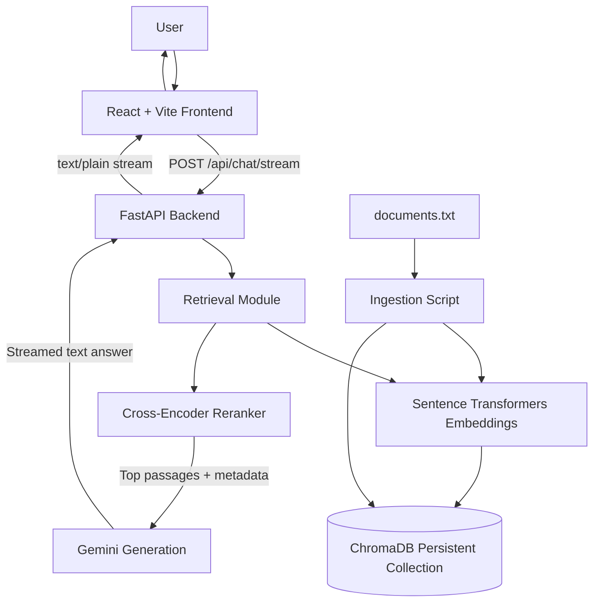

# Day 150 — Write the README with an Architecture Diagram and Evaluation Results

**Date:** Wednesday, October 28, 2026  
**Time:** 9:00–10:00 PM  
**Week 22:** Ship Project 4 — Phase 4: Retrieval-Augmented Generation (RAG)  
**Commit:** 150 of 365

## Today's goal

Make `production-grade-rag` understandable to someone who has never seen the project before. By the end of the hour, your README should explain what the app does, how a question travels through the RAG pipeline, how to install and run it, how to test it, and what the evaluation results actually show.

**Important:** Do not invent evaluation numbers. Run your existing tests and record the real results. If you have not built a formal evaluation suite, say so and report only measurements you actually collected.

---

## 1. Learn — README and architecture diagrams (30 minutes)

A README is the project's front door. A developer should be able to understand the project and run it without needing you to explain every step.

A useful technical README usually contains:

1. **Overview** — what it does and why it exists.
2. **Features** — implemented features only.
3. **Architecture** — components and data flow.
4. **Tech stack** — languages, frameworks, models, and storage.
5. **Prerequisites and setup** — software, credentials, and commands.
6. **API usage** — endpoint, request format, and response behavior.
7. **Evaluation** — tests run, metrics, results, and limitations.
8. **Known limitations / future work** — honest notes about what is not finished.

### Your RAG architecture

The intended flow in your project is:

1. The user submits a question in the React + Vite frontend.
2. The frontend sends it to FastAPI.
3. The retrieval module searches the persistent ChromaDB collection.
4. Sentence Transformers supports semantic retrieval.
5. A cross-encoder reranks retrieved passages and selects the strongest matches.
6. The generation module sends the question and selected passages to Gemini.
7. Gemini streams an answer back through FastAPI to the frontend.

Check the code before documenting optional features such as caching, rate limiting, or source cards. Do not claim they are implemented unless they are.

### Mermaid architecture diagram

GitHub can render Mermaid diagrams in Markdown. Add a diagram like this to `README.md` and adjust it if your code differs:



---

## 2. Build — Write `README.md` (30 minutes)

Open a CMD terminal and go to the repository root:

```cmd
cd /d "D:\python projects\gen 365\production-grade-rag"
```

Create or edit `README.md`. Use this outline, replacing any details that do not match your actual code:

```markdown
# Production RAG App

A Retrieval-Augmented Generation (RAG) application that retrieves relevant
document passages and uses Gemini to generate an answer grounded in those passages.

## Features
- Document ingestion and chunking
- Semantic retrieval using Sentence Transformers
- Persistent vector storage with ChromaDB
- Cross-encoder reranking
- Gemini-based answer generation
- FastAPI endpoint for streamed responses
- React + Vite chat interface

## Architecture
[Paste the Mermaid diagram here.]

## Tech Stack
- Python and FastAPI
- ChromaDB
- Sentence Transformers
- Cross-Encoder reranking
- Google Gemini API
- React and Vite

## Project Structure
- `data/documents.txt` — sample knowledge source
- `src/ingestion.py` — chunks and indexes the source document
- `src/retrieval.py` — retrieves and reranks relevant passages
- `src/reranking.py` — cross-encoder reranking
- `src/generation.py` — generates a grounded answer with Gemini
- `src/main.py` — FastAPI application
- `frontend/` — React + Vite interface
- `chroma_data/` — local ChromaDB persistence (generated locally)

## Prerequisites
- Python
- Node.js and npm
- A Gemini API key

## Backend Setup
[Document your verified environment, dependency-install, ingestion, and server commands.]

## Frontend Setup
[Document your verified npm install and development-server commands.]

## API
`POST /api/chat/stream`

Request:
{
  "message": "Ask a question about the indexed documents"
}

Response: streamed plain-text answer.

## Evaluation
Record the tests you actually ran, date, sample size, and measured results.

## Limitations
- Answers depend on the indexed documents.
- Retrieval can miss relevant passages.
- Generation can still make unsupported claims.
- The current API returns streamed plain text; structured source cards are not included unless implemented separately.

## Future Improvements
- Expand the evaluation dataset
- Measure retrieval quality and answer faithfulness
- Add structured citation metadata to the API response
- Add automated regression tests
```

### Verify your setup commands

Typical Windows CMD commands may look like these. Check your actual files before documenting them.

**Backend**, from the repository root:

```cmd
.venv\Scripts\activate
pip install -r requirements.txt
uvicorn src.main:app --reload --port 8000
```

**Ingestion** — only if `src/ingestion.py` supports module execution:

```cmd
python -m src.ingestion
```

**Frontend**, in a second CMD window:

```cmd
cd frontend
npm install
npm run dev
```

Root `.env` example:

```dotenv
GEMINI_API_KEY=replace_with_your_own_key
GEMINI_MODEL=gemini-2.5-flash
```

Never put your real API key in `README.md`, screenshots, or Git. Keep `.env` ignored by Git. A `.env.example` should contain placeholders only.

---

## 3. Evaluation results: report evidence, not guesses

Run the tests you already have from the repository root:

```cmd
python -m pytest -q
```

If no automated tests exist, do not claim the command passed. Instead, record a small manual smoke-test and label it clearly as manual.

| Check | How to test | Result to record |
|---|---|---|
| Backend health | Open `http://localhost:8000/` | Actual status |
| API docs | Open `http://localhost:8000/docs` | Pass/Fail |
| Answerable question | Ask something covered by `documents.txt` | Is the answer supported? |
| Unknown question | Ask something not covered by the document | Does it admit insufficient evidence? |
| Streaming | Observe whether text appears progressively | Pass/Fail |
| Automated tests | `python -m pytest -q` | Actual pass/fail count, or “No automated tests configured” |
| Latency | Time representative requests | Actual measurements and sample size |

If you measure latency, test several questions and record the sample size. Do not present a single request as a reliable benchmark.

Use a results table like this, filling in only measured values:

| Metric | Measured result |
|---|---|
| Test date | `YYYY-MM-DD` |
| Manual questions tested | `N` |
| Grounded answers | `N / N` |
| Unknown-question abstention | `N / N` |
| Median response time | `N seconds` |
| Automated tests | `N passed, N failed` |

These are placeholders, not results. If you have not measured a metric, write **“Not measured yet.”** Transparent manual evaluation is better than fabricated precision.

---

## 4. Final checks and Git commit

Before committing, check that:

- [ ] The diagram matches the actual data flow.
- [ ] Setup commands have been verified.
- [ ] The endpoint and request format are correct.
- [ ] Evaluation results are real and dated.
- [ ] Limitations are stated honestly.
- [ ] No API keys or secrets are included.
- [ ] `.env` and `chroma_data/` are not accidentally tracked.

Run:

```cmd
git status
git diff -- README.md
```

If the README is correct:

```cmd
git add README.md
git commit -m "docs: add RAG architecture and evaluation results"
git push
```

If you create a separate evaluation report, add it too. Do not add `.env`, virtual environments, model caches, or local vector-store data.

---

## 5. Definition of done

Day 150 is complete when:

- `README.md` explains the project and setup.
- The architecture diagram is present and accurate.
- The API endpoint is documented.
- Evaluation results reflect actual tests or are explicitly marked as not measured.
- The changes are committed and pushed to GitHub.

### One-hour plan
- **0–10 min:** Review architecture and inspect actual entry points.
- **10–20 min:** Add overview, stack, project structure, and Mermaid diagram.
- **20–40 min:** Add setup, API, evaluation table, and limitations.
- **40–50 min:** Run smoke tests and fill in real results.
- **50–60 min:** Review `git diff`, commit, and push.
