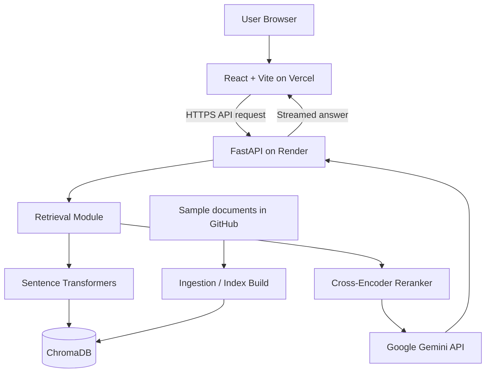

# Day 154 — Ship Project 4: Deploy, Publish, Reflect and Plan Phase 5

**Date:** Sunday, November 1, 2026  
**Time:** 9:00–10:00 PM  
**Week 22:** Project 4 — Phase 4: Retrieval-Augmented Generation  
**Milestone:** Project 4 goes live

## Objective

Deploy the React + Vite frontend to Vercel and the FastAPI backend to Render, connect them securely, verify the public RAG workflow, add the project to your portfolio, publish a Medium walkthrough, reflect, and choose Phase 5 priorities.

**Important:** A public URL does not automatically mean the RAG app is production-ready. Test retrieval, generation, streaming, CORS, secrets and vector-store persistence before claiming it is live.

---

## 1. LEARN — Reflection (30 minutes)

Reflect on these five questions:

1. What problem does your RAG application solve?
2. What happens between a user's question and the final answer?
3. Why did you choose ChromaDB, Sentence Transformers, a cross-encoder, Gemini, FastAPI and React?
4. What did your end-to-end tests reveal? Which tests passed or failed?
5. What remains fragile or incomplete?

### Project story

Use this as a starting point, and adjust it to match the actual implementation:

> I built a Retrieval-Augmented Generation application that answers questions using a supplied knowledge base. Documents are chunked and embedded, stored in ChromaDB, retrieved through semantic search, and reranked with a cross-encoder. Selected passages are sent to Gemini, which generates a response streamed through FastAPI to a React frontend. I test answerable and unanswerable questions to assess retrieval, grounding and failure handling.

### Intended deployment architecture



Update the diagram if your final deployment architecture differs.

---

## 2. BUILD — Deploy the application (30 minutes)

A first deployment may take longer than 30 minutes, particularly while Python packages and embedding models download. Do not skip persistence or security checks just to claim completion.

### Step 1 — Pre-deployment checks

In Windows CMD:

```cmd
cd /d "D:\python projects\gen 365\production-grade-rag"
git status
```

Confirm:
- Latest working code is committed and pushed.
- `requirements.txt` contains backend runtime dependencies.
- `.env` is ignored by Git.
- `.venv/`, `node_modules/` and `chroma_data/` are not accidentally committed.
- The sample corpus is committed.
- Gemini API key is not in frontend code.
- Local end-to-end tests have been run.

If a secret was ever committed, rotate it in Google AI Studio. Removing it from the latest version is not sufficient.

### Step 2 — Prepare FastAPI for Render

Render web services must listen on `0.0.0.0` and the platform-provided `PORT`.

Typical Render settings:

| Setting | Value |
|---|---|
| Service | Web Service |
| Runtime | Python |
| Root directory | Repository root |
| Build command | `pip install -r requirements.txt` |
| Start command | `python -m uvicorn src.main:app --host 0.0.0.0 --port $PORT` |
| Health check | `/` |

Your current `src/` and `requirements.txt` are at the repository root, so use that as the service root unless your repository layout has changed.

In Render Environment settings, add backend-only variables:

```text
GEMINI_API_KEY = your actual Gemini key
GEMINI_MODEL = gemini-2.5-flash
```

Use the model name you actually tested. Never put the key in GitHub, README, browser code or a `VITE_` variable.

### Step 3 — Configure CORS

Your local FastAPI app may currently allow only `http://localhost:5173`. Add the exact Vercel production origin, for example:

```text
https://your-project-name.vercel.app
```

Keep the localhost origin for development if required. Avoid wildcard origins when credentials are enabled.

### Step 4 — Decide how ChromaDB will persist

This is critical. Your local `chroma_data/` directory does not automatically appear on Render.

Choose one strategy and implement it:

**Option A — Render persistent disk**
- Persistent disks are available on paid Render services.
- Attach a disk to the backend service.
- Choose a mount path such as `/opt/render/project/src/storage`.
- Configure ChromaDB to persist inside that mount path.
- Build/populate the collection and test it after a restart.
- Note: disks are attached to a single service instance and have deployment/availability trade-offs.

**Option B — Rebuild the index from the committed sample corpus**
- Keep the sample corpus in Git.
- Configure the backend to build the index when required.
- Verify model downloads and ingestion complete reliably.
- Do not assume files written to Render's default filesystem survive restarts or redeploys.
- This is suitable for a small demo but can increase startup time and resource use.

**Option C — Hosted vector database**
- Move vectors and metadata to a managed vector database.
- Store its credentials in backend environment variables.
- Update both ingestion and retrieval code.

Do not deploy assuming your local ChromaDB data will be present. Render's default filesystem is ephemeral.

### Step 5 — Deploy the backend

1. Sign in to Render.
2. Create a Web Service and connect the GitHub repository.
3. Set the build command, start command, environment variables, health-check path and ChromaDB persistence strategy.
4. Deploy and inspect build/runtime logs.
5. Open the public service URL, e.g. `https://your-api.onrender.com/`.
6. Open `/docs`.
7. Test `POST /api/chat/stream`.

Record the real backend URL.

### Step 6 — Prepare the Vite frontend

Your frontend currently calls a local API URL. Replace the hard-coded URL with a Vite environment variable.

Create `frontend/.env` for local development:

```dotenv
VITE_API_BASE_URL=http://localhost:8000
```

In your frontend code, adapt the fetch call to use:

```javascript
const API_BASE_URL =
  import.meta.env.VITE_API_BASE_URL || "http://localhost:8000";
```

Then call:

```javascript
fetch(`${API_BASE_URL}/api/chat/stream`, ...)
```

This is an example; integrate it into your existing `App.jsx` fetch logic.

In Vercel project settings, add:

```text
VITE_API_BASE_URL = https://your-real-render-service.onrender.com
```

Replace the example with your actual backend URL. Vite variables prefixed with `VITE_` are exposed to browser code. Never put private API keys there.

### Step 7 — Deploy the frontend to Vercel

1. Sign in to Vercel and import your GitHub repository.
2. Set the project root to `frontend`.
3. Select Vite if asked for a framework.
4. Build command: `npm run build`.
5. Output directory: `dist`.
6. Add `VITE_API_BASE_URL` with the real Render URL.
7. Deploy and open the public URL.

If you change a Vercel environment variable, redeploy so the new value is included in the build.

### Step 8 — Test the public application

Run these tests against the deployed URLs:

| Test | Expected result |
|---|---|
| Vercel frontend | Page loads over HTTPS |
| Render health endpoint | Health response returned |
| API docs | FastAPI docs load, if publicly enabled |
| Answerable question | Answer is supported by sample corpus |
| Unknown question | App acknowledges missing information |
| Streaming | Answer appears progressively |
| CORS | No browser CORS error |
| Vector persistence | Index survives restart, or rebuild strategy works |
| API key | Not visible in browser source or GitHub |

Check Render logs and browser developer tools when requests fail. A working homepage alone does not prove the RAG pipeline works.

Record the frontend URL, backend URL, deployment date, vector persistence strategy, test results and known issues.

---

## 3. Add Project 4 to your portfolio

Use this portfolio entry, adjusting it to match the live implementation:

**Project:** Production RAG Application

**Description:** A full-stack Retrieval-Augmented Generation application that uses semantic retrieval, cross-encoder reranking and Gemini to generate answers grounded in a sample knowledge base.

Include:
- Live demo URL.
- GitHub repository URL.
- Architecture diagram.
- Three real application screenshots.
- Technology stack.
- Short explanation of the RAG pipeline.
- Actual evaluation results.
- Known limitations.

Do not publish a live link until public end-to-end tests pass.

---

## 4. Publish the Medium walkthrough

**Suggested title:** A Production-Grade RAG App from Scratch

Recommended article structure:

1. Introduction — what you built and why.
2. What is RAG? — retrieval plus generation.
3. Architecture — include your architecture diagram.
4. Document ingestion — chunking and embeddings.
5. Semantic retrieval — ChromaDB and Sentence Transformers.
6. Reranking — why a cross-encoder is used.
7. Generation — Gemini and grounded prompting.
8. Backend and frontend — FastAPI, streaming, React and Vite.
9. Evaluation — test method, questions, actual results and failures.
10. Deployment — hosting architecture and vector-store persistence.
11. Lessons learned — trade-offs, limitations and next steps.

Use your own screenshots and actual test evidence. Mark unmeasured metrics as “Not measured”. Do not claim production readiness merely because the app has a public URL.

---

## 5. Reflect and plan Phase 5

Write short answers:

- What was the hardest technical problem?
- Which part of the RAG pipeline do you understand best?
- Which part is still fragile?
- What did end-to-end tests reveal?
- What would you redesign if starting again?
- What did you learn about deploying AI applications?

### Suggested Phase 5 priorities

Choose priorities based on actual test failures and limitations:

1. **Structured citations:** return answer text and source metadata in a structured response.
2. **Evaluation harness:** build a repeatable dataset and measure retrieval and answer quality.
3. **Hybrid retrieval:** combine semantic search with keyword/BM25 search.
4. **Observability:** measure latency and errors in retrieval, reranking and generation.
5. **Security:** add validation, rate limiting and authentication as appropriate.
6. **Document management:** support uploads, indexing status and safe re-ingestion.

Do not attempt all of these at once. Pick two or three high-value priorities.

---

## 6. Git commit and push

After updating code, README, screenshots or test reports:

```cmd
git status
git diff
```

Stage only intended changes. For example:

```cmd
git add README.md docs frontend src
git commit -m "ship: deploy and document production RAG app"
git push
```

Only stage directories that contain changes you intend to publish. Never stage `.env`, secrets, `.venv/`, `node_modules/` or generated `chroma_data/` without a deliberate, reviewed reason.

---

## Definition of done

- [ ] FastAPI backend deployed to Render.
- [ ] React frontend deployed to Vercel.
- [ ] Gemini key stored only in backend environment variables.
- [ ] Frontend uses deployed backend URL.
- [ ] CORS allows the production frontend origin.
- [ ] ChromaDB persistence/rebuild strategy implemented and tested.
- [ ] Live answerable question tested.
- [ ] Live unanswerable question tested.
- [ ] Live streaming tested.
- [ ] Live demo and GitHub repository added to portfolio.
- [ ] Medium walkthrough published, or draft completed if deployment needs more time.
- [ ] Reflection and Phase 5 priorities written.
- [ ] Changes committed and pushed.

## One-hour plan

| Time | Activity |
|---|---|
| 8:50–9:00 PM | Open project, check Git status, confirm local app and hosting accounts |
| 9:00–9:10 PM | Reflect on problem, architecture and lessons |
| 9:10–9:20 PM | Review deployment architecture and choose ChromaDB persistence strategy |
| 9:20–9:35 PM | Configure/deploy backend and frontend |
| 9:35–9:45 PM | Test public app and record URLs/results |
| 9:45–9:55 PM | Add portfolio entry; prepare or publish Medium article |
| 9:55–10:00 PM | Plan Phase 5, commit and push |

**If deployment takes longer:** Prioritise a secure, functioning deployment with verified vector persistence. Finish the portfolio and Medium publication after the public app passes end-to-end tests.

---

## Official deployment references

- Render Web Services: https://render.com/docs/web-services
- Render persistent disks: https://render.com/docs/disks
- Render deploy behavior: https://render.com/docs/deploys
- Vercel Vite deployment: https://vercel.com/docs/frameworks/frontend/vite
- Vercel environment variables: https://vercel.com/docs/environment-variables
