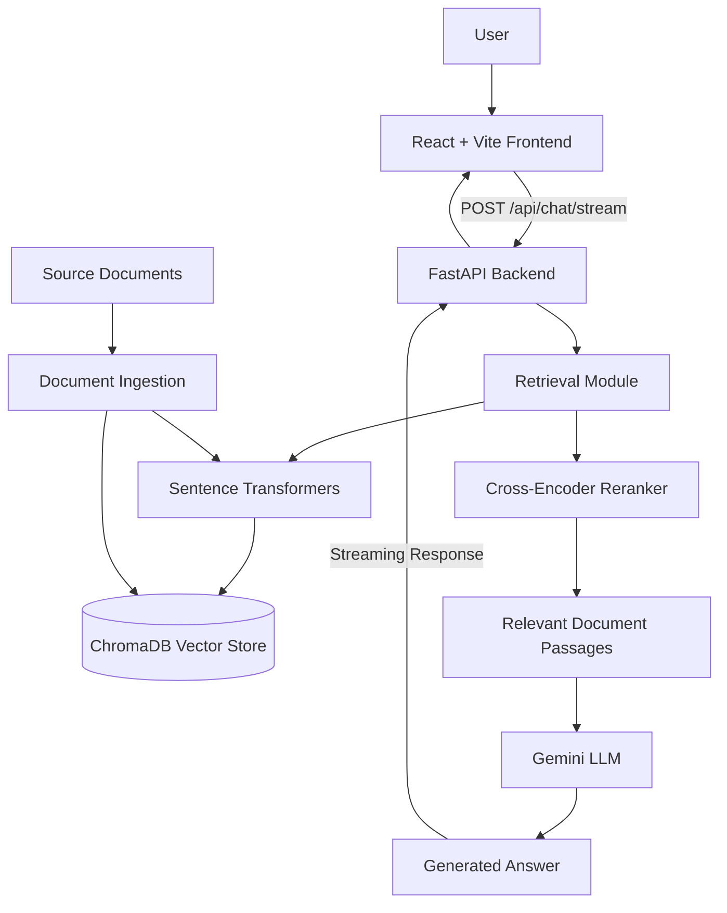

# Production RAG App

A Retrieval-Augmented Generation (RAG) application that combines semantic search, document retrieval, cross-encoder reranking and Large Language Model (LLM) generation to produce context-aware answers from a custom knowledge base.

The application uses **ChromaDB** for vector storage, **Sentence Transformers** for semantic retrieval, **Gemini** for answer generation, and **FastAPI** to serve the backend.

---

## 1. Project Overview

Traditional LLM applications can generate answers without having access to specific private or custom knowledge.

This project addresses that limitation through Retrieval-Augmented Generation (RAG).

Instead of relying entirely on the LLM's pretrained knowledge, the application:

1. Processes and indexes documents.
2. Converts text into vector embeddings.
3. Retrieves relevant document passages based on user queries.
4. Reranks retrieved passages according to relevance.
5. Supplies the selected context to Gemini.
6. Generates an answer grounded in the retrieved information.

---

## 2. Key Features

* **Document Ingestion:** Processes and splits documents into smaller chunks.
* **Semantic Search:** Retrieves relevant information using vector embeddings.
* **Vector Database:** Stores document embeddings using ChromaDB.
* **Cross-Encoder Reranking:** Reorders retrieved passages based on relevance.
* **LLM Integration:** Uses Google Gemini for contextual answer generation.
* **Streaming Responses:** Streams generated answers to the frontend.
* **REST API:** Provides backend functionality through FastAPI.
* **Interactive Interface:** React-based chat interface for interacting with the knowledge base.

---

## 3. System Architecture

The application follows a modular RAG architecture.

### Architecture Diagram



### RAG Workflow

**Step 1 — Document Ingestion**

Source documents are loaded and divided into smaller text chunks.

**Step 2 — Embedding Generation**

Sentence Transformers converts document chunks into numerical vector representations.

**Step 3 — Vector Storage**

The generated embeddings and associated metadata are stored in ChromaDB.

**Step 4 — Semantic Retrieval**

When a user submits a question, the system retrieves the most relevant document passages.

**Step 5 — Reranking**

A Cross-Encoder evaluates the retrieved passages and ranks them according to their relevance to the query.

**Step 6 — Answer Generation**

The selected passages are provided to Gemini as context.

**Step 7 — Response Streaming**

The generated answer is streamed through FastAPI and displayed in the React interface.

---

## 4. Technology Stack

| Component           | Technology                           |
| ------------------- | ------------------------------------ |
| Frontend            | React.js                             |
| Frontend Build Tool | Vite                                 |
| Backend             | Python, FastAPI                      |
| Vector Database     | ChromaDB                             |
| Embedding Model     | all-MiniLM-L6-v2                     |
| Reranking Model     | cross-encoder/ms-marco-MiniLM-L-6-v2 |
| LLM                 | Google Gemini                        |
| API Communication   | REST API                             |
| Response Delivery   | StreamingResponse                    |
| Version Control     | Git and GitHub                       |

---

## 5. Project Structure

```text
production-grade-rag/
│
├── data/
│   └── documents.txt
│
├── src/
│   ├── __init__.py
│   ├── ingestion.py
│   ├── retrieval.py
│   ├── reranking.py
│   ├── generation.py
│   └── main.py
│
├── frontend/
│   ├── src/
│   │   ├── App.jsx
│   │   └── App.css
│   ├── package.json
│   └── index.html
│
├── docs/
│   └── images/
│       ├── rag-chat-interface.png
│       ├── rag-generated-answer.png
│       └── rag-api-documentation.png
│
├── chroma_data/
│
├── .env
├── .gitignore
├── requirements.txt
└── README.md
```

*Note: `chroma_data/` and `.env` are local files and should not be committed to GitHub.*

---

## 6. Installation and Setup

### Prerequisites

Make sure you have installed:

* Python 3.10+
* Node.js and npm
* Git
* Google Gemini API key

### Step 1 — Clone the repository

```bash
git clone YOUR_GITHUB_REPOSITORY_URL
```

```bash
cd production-grade-rag
```

### Step 2 — Create a virtual environment

```bash
python -m venv .venv
```

Activate it on Windows:

```cmd
.venv\Scripts\activate
```

### Step 3 — Install backend dependencies

```bash
pip install -r requirements.txt
```

### Step 4 — Configure environment variables

Create a `.env` file in the root directory.

```env
GEMINI_API_KEY=your_gemini_api_key
GEMINI_MODEL=gemini-2.5-flash
```

Never expose your actual API key or commit your `.env` file.

### Step 5 — Prepare the vector database

Run the document ingestion process using the execution method configured in `src/ingestion.py`.

This processes the source document and stores its embeddings in ChromaDB.

### Step 6 — Start the backend

```bash
python -m uvicorn src.main:app --reload --port 8000
```

Backend:

`http://localhost:8000`

API documentation:

`http://localhost:8000/docs`

### Step 7 — Start the frontend

Open another terminal:

```bash
cd frontend
```

Install frontend dependencies:

```bash
npm install
```

Start the development server:

```bash
npm run dev
```

Frontend:

`http://localhost:5173`

---

## 7. API Documentation

### Chat Streaming Endpoint

**Endpoint**

`POST /api/chat/stream`

**Description**

Accepts a user question, retrieves relevant document passages, reranks them and generates a contextual answer using Gemini.

**Request Body**

```json
{
  "message": "What is the main topic covered in the knowledge base?"
}
```

**Response**

The endpoint returns a streamed plain-text response.

**Example cURL Request**

```bash
curl -N -X POST http://localhost:8000/api/chat/stream \
-H "Content-Type: application/json" \
-d "{\"message\":\"Summarise the knowledge base\"}"
```

---

## 8. Application Screenshots

### Chat Interface


### Generated Answer


### Backend API Documentation


---

## 9. Evaluation and Testing

The application should be evaluated across retrieval quality, answer quality, reliability and response latency.

### Evaluation Checklist

| Test               | Purpose                                     | Result               |
| ------------------ | ------------------------------------------- | -------------------- |
| Relevant Question  | Verify document retrieval                   | Update after testing |
| Semantic Search    | Check relevance of retrieved passages       | Update after testing |
| Reranking          | Verify relevance-based passage ordering     | Update after testing |
| Grounded Answer    | Check whether answers use retrieved context | Update after testing |
| Unknown Question   | Test handling of missing information        | Update after testing |
| Streaming Response | Verify progressive answer delivery          | Update after testing |
| API Health         | Verify backend availability                 | Update after testing |

### Evaluation Results

| Metric                   | Result                     |
| ------------------------ | -------------------------- |
| Number of test questions | Not measured yet           |
| Retrieval accuracy       | Not measured yet           |
| Answer faithfulness      | Not measured yet           |
| Average response latency | Not measured yet           |
| Automated test results   | Update after running tests |

Evaluation results will be updated as testing progresses.

---

## 10. Current Limitations

* Retrieval quality depends on document quality and chunking strategy.
* The system may fail to retrieve relevant passages for ambiguous questions.
* LLM-generated answers require grounding and verification.
* The current API returns plain-text streaming responses.
* The current application uses local ChromaDB persistence.
* Production deployment and persistent cloud infrastructure require additional configuration.

---

## 12. Learning Outcomes

Through this project, I explored and implemented several important concepts in modern AI application development:

* Retrieval-Augmented Generation (RAG)
* Text chunking and embedding generation
* Vector databases and semantic search
* Cross-Encoder reranking
* LLM integration
* Prompt engineering and grounded generation
* Streaming APIs with FastAPI
* Full-stack application development
* Evaluation and testing of AI applications
